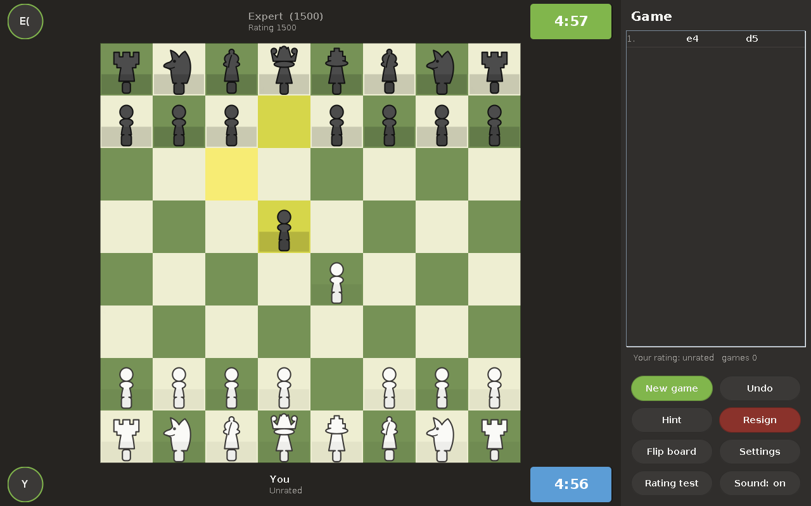

# chess

A 2D chess game in plain Java.  The look and the feel are the ones of
chess.com: a dark window, a green board, rounded buttons, a score sheet on
the side, a clock for every player and a computer opponent that plays at six
different strengths.

Everything is written with the Java standard library only.  There is no
framework, no library and no picture in the source tree - the pieces are
drawn as vectors and the sounds are calculated on the spot.



## What it does

| | |
| --- | --- |
| **The board** | 2D board, the pieces are drawn, the moves are animated, the square of the king in check is red |
| **The rules** | all of them: castling, en passant, promotion, the fifty move rule, repetition, not enough material |
| **The computer** | six levels, from a beginner that hangs pieces to a master that calculates eight moves ahead |
| **The rating** | Glicko-2, the system chess.com uses, with a rating test of ten games |
| **The clock** | minutes per player, seconds after a move, the game is over when the time is up |
| **The sounds** | move, capture, castle, check, win, loss and draw |
| **The list of moves** | the notation of a score sheet, with the numbers of the moves |
| **The rest** | take a move back, a hint, turn the board around, play against a friend on the same computer |

## Building

A JDK (17 or newer) is all that is needed:

```bash
./build.sh          # builds dist/chess.jar
./build.sh test     # builds and runs the checks
```

The game is started with:

```bash
./run.sh
```

or directly:

```bash
java -jar dist/chess.jar
```

## The game on the phone

The same game runs on a phone.  The rules, the computer and the rating are
the code of the game on the computer, only the part that draws the game is
written for Android.

The apk is built with [Gradle](https://gradle.org) and the plugin of Android:

```bash
cd android
./build-apk.sh      # builds app/build/outputs/apk/release/app-release.apk
```

The file is put on the phone with `adb install app/build/outputs/apk/release/app-release.apk`
or by opening it on the phone.  The apk is signed with the key of the debug
build, so Android asks first whether the unknown source may be used.  A key
of your own is used when it is given to the build:

```bash
./build-apk.sh -Pchess.keystore=/path/to/key.jks \
    -Pchess.keystore.password=... \
    -Pchess.key.alias=... \
    -Pchess.key.password=...
```

The checks of the game for the phone are run with:

```bash
cd android
./gradlew testDebugUnitTest
```

## Playing

* **New game** - against the computer or against a friend on the same
  computer, with the time control of your choice.
* **The board** - click a piece and click the square it should go to, or drag
  it there.  The dots show where the piece can go.
* **Undo** - takes the last move back, and the move of the computer with it.
* **Hint** - the computer looks for the best move and shows it.
* **Resign** - gives the game up.
* **Flip board** - turns the board around.
* **Rating test** - ten games against the computer, the computer gets
  stronger while the test goes on.  The rating that comes out is a Glicko-2
  rating, the same system chess.com uses.

The settings (the name, the sound and the volume) are kept in
`~/.chess/chess.properties`, the rating is kept there as well.

## The engine

The engine is written from scratch:

* **the rules** - the move generator makes the moves and throws away the ones
  that leave the king in check.  The whole rule set is checked with perft, the
  count of the move trees of a position.
* **the search** - negamax with the alpha beta cut off, a table of
  transpositions, the search of the captures when the position is quiet
  (quiescence), killer moves and a deeper search of every position again and
  again (iterative deepening).
* **the evaluation** - the material, the place of the pieces on the board,
  the pawn structure, the rooks on open files, the safety of the king and the
  king that goes to the centre when the queens are off.  The middle game and
  the end game are weighed separately and mixed.
* **the levels** - every level has a depth and a rate of mistakes.  The
  mistake is not a wild move, it is a move that is close to the best one.

The levels are measured against each other, the results are in
[docs/levels.md](docs/levels.md).

## The source tree

```
src/main/java/com/mmunki/chess
├── Main.java              the start of the game
├── core/                  the rules: board, moves, notation, the result
├── ai/                    the evaluation, the search and the levels
├── rating/                Glicko-2 and the rating test
├── audio/                 the sounds
├── ui/                    the window, the board, the pieces, the dialogs
└── util/                  the settings
src/test/java/com/mmunki/chess/test
├── Perft.java             the count of the move trees
├── EngineCheck.java       the checks of the rules
├── EngineCheck2.java      the checks of the computer
├── RatingCheck.java       the checks of the rating
├── RoundTrip.java         every move has to be able to be taken back
├── Calibrate.java         the measurement of the levels
├── RenderPieces.java      draws the pieces into a picture
└── UiShot.java            takes a picture of the window
android/app/src/main/java/com/mmunki/chess/android
├── MainActivity.java      the window of the game on the phone
├── BoardView.java         the board with the pieces on it
├── PiecePainter.java      the pieces as vectors
├── ClockView.java         the clock of a player
├── PlayerBar.java         the bar of a player
├── MoveListView.java      the list of the moves
├── FlatButton.java        a button in the style of the game
├── AvatarView.java        the picture of a player
├── AudioEngine.java       the sounds
├── Settings.java          the settings of the game
└── Theme.java             the colours of the game
```

## The checks

```bash
./build.sh test
```

The checks walk through the move trees of six positions and compare the
number of leaves with the numbers that are known, they play a whole game
between two computers, they look for the mates in one and two and they check
the rating against the example of the paper of Mark Glickman.

## The licence

Apache License 2.0, the same licence as the other projects of the owner.
